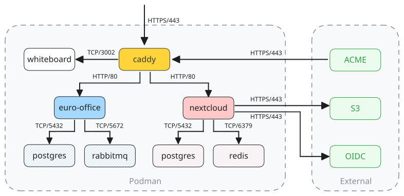

# Nextcloud Enclave

A Podman Nextcloud deployment for small to medium sized organizations.  


## Overview
What's different to other deployments out in the wild?

- BYO CA so you can connect to your internal services that are issued with your organizations certificates
- S3 is the primary data storage for nextcloud
- Caddy reverse proxy handles certificate management via ACME and terminates SSL
- Euro-Office integrated
- Whiteboard integrated
- All containers are read-only except nextcloud and euro-office-documentserver
- All persistent data is written to named volumes
- All containers are network-isolated and only allowed required connections
- All containers have capabilities approriate to their tasks
- Hardened Chainguard containers for Postgres and Redis
- rootless through Podman
- Basic backup and restore functionality for Nextcloud


## Architecture



## Requirements

2 self-hosted or external services
- S3 storage
- ACME server
</br>

2 domains
- nextcloud.domain.tld
- office.domain.tld


## CA trust
If you happen to run your own certificate authority (CA) your internal CA certificate must be present in `/etc/ssl/certs/ca-certificates.crt` on the container engine host. This file is bind-mounted into all containers that need trust to your CA (self-hosted services like OIDC server, S3, ACME, etc). 


### The Nextcloud CA trust problem

Nextcloud's entrypoint uses `rsync` to initialise `/var/www/html` on first boot. Bind-mounting files into that tree (such as `ca-bundle.crt` or `custom.config.php`) causes `rsync` to fail with `Device or resource busy` because it cannot rename over a mount point. The container will loop indefinitely.

Additionally, Nextcloud's Guzzle HTTP client ignores PHP's `curl.cainfo` setting. It hardcodes its own CA bundle at `/var/www/html/resources/config/ca-bundle.crt`. System `curl` inside the container will work fine while Nextcloud itself fails ...


`before-starting` hook scripts run after `rsync` completes, but before the web server starts, writing necessary configs to establish trust.


## Pre-installing apps 

`post-installation` hook scripts install the following apps 


- [eurooffice](https://apps.nextcloud.com/apps/eurooffice) (shown as "Nextcloud Office" in the app store, requires Nextcloud 33+)
- [office](https://apps.nextcloud.com/apps/office) (installed alongside eurooffice)
- [whiteboard](https://apps.nextcloud.com/apps/whiteboard)
- [oidc_login](https://apps.nextcloud.com/apps/oidc_login)
- [calendar](https://apps.nextcloud.com/apps/calendar)
- [contacts](https://apps.nextcloud.com/apps/contacts)
- [tasks](https://apps.nextcloud.com/apps/tasks)
- [notes](https://apps.nextcloud.com/apps/notes)
- [mail](https://apps.nextcloud.com/apps/mail)

Recommended Nextcloud apps (https://nextcloud.domain.tld/index.php/core/apps/recommended) are installed, with exception to Nextcloud Talk and Nextcloud Office/Collabora. An addition to this list is the oidc_login and eurooffice app. The official Nextcloud `user_oidc` requires `allow_local_remote_servers=true` to contact OIDC providers on private networks, which weakens Nextcloud's built-in SSRF protections. `oidc_login` works against internal providers without that trade-off.


### The half-automatic way
If JWT secrets for Euro-Office and whiteboard are configured (only) in their respective env files, you have to go to your Nextcloud instance and fill in these secrets for Euro-Office at https://nextcloud.domain.tld/settings/admin/eurooffice and for whiteboard at https://nextcloud.domain.tld/whiteboard/

>**NOTE** Using JWT secrets in the post-installation scripts to auto-configure Euro-Office and whiteboard is basically broken. The scripts install, configure and enable the apps, but since the lack of ca trust during the entire installation phase (see CA trust above) both configurations are just pre-set. You are unfortunately still required to go to the two links above and click save, to apply and run the configuration.


## Deployment

```
git clone https://github.com/littleoffice/nextcloud_enclave.git
```

Change domain.tld in:
- configs/Caddyfile
- envs/nextcloud.env
- hooks/post-installation/eurooffice.sh
- hooks/post-installation/board.sh

Change SECRET in:
- configs/nextcloud-redis.conf
- envs/nextcloud-postgres.env
- envs/nextcloud.env
- envs/euro-office-postgres.env
- envs/euro-office-rabbitmq.env
- envs/euro-office-documentserver.env

```
podman-compose up -d 
```

To verify the Euro-Office connection from Nextcloud:

```
podman exec -u www-data nextcloud php occ eurooffice:documentserver --check
```

| Deployment | Time |
|---|---|
| Without apps | ~45 seconds
| With apps |  ~90 seconds

>**NOTE** Keep in mind that first logins can take a bit. Be patient


### Upgrading from OnlyOffice

>**WARNING** The switch from OnlyOffice to Euro-Office is a breaking change. Containers, networks, volumes, env files and the Nextcloud app were all renamed.

| Before | After |
|---|---|
| `onlyoffice-documentserver`, `onlyoffice-postgres`, `onlyoffice-rabbitmq` | `euro-office-documentserver`, `euro-office-postgres`, `euro-office-rabbitmq` |
| `envs/onlyoffice-*.env` | `envs/euro-office-*.env` |
| `onlyoffice_*` volumes, `onlyoffice_postgres` network | `euro-office_*` volumes, `euro-office_postgres` network |
| Nextcloud app `onlyoffice` | Nextcloud apps `eurooffice` and `office` |

1. Stop the stack: `podman-compose down`.
2. Rename your env files and change the hostnames inside them (`DB_HOST`, `AMQP_URI`) to the new `euro-office-*` container names.
3. Nextcloud only supports upgrading one major version at a time. If you are on 33, start on `nextcloud:34-apache` first, let the upgrade finish, then switch to 35.
4. `podman-compose up -d`. The document server starts with fresh volumes. The old `onlyoffice_*` volumes are no longer used and can be removed with `podman volume rm` once everything works.
5. Post-installation hooks only run on a fresh install, so on an existing instance install the apps by hand:

```
podman exec -u www-data nextcloud php occ app:disable onlyoffice
```

```
podman exec -u www-data nextcloud php occ app:install eurooffice
```

```
podman exec -u www-data nextcloud php occ app:install office
```

6. Set the document server URL and JWT secret at https://nextcloud.domain.tld/settings/admin/eurooffice and click save.


### OIDC 

The implementation is based on the official [Authentik integration](https://integrations.goauthentik.io/chat-communication-collaboration/nextcloud/). OIDC is added through a `before-starting` script, similarly like the CA trust is established. <br>
>**NOTE** If OIDC url, client id or secret are not set in `.envs/nextcloud.env`, the oidc installation is skipped entirely.


## Security

[SOPS](https://github.com/getsops/sops) with [age](https://github.com/FiloSottile/age) is the recommended way of handling
- configs/redis.conf
- envs/*.env

</br>

The pre-set options in the hookscripts to set secrets in Nextcloud is intentionally not used because it would make secret management unnecessarily more annoying. They are mostly there for documentation/testing purposes.


## Backup

>**WARNING**`neb.sh` backs up Nextclouds configuration, database, and installed apps. <b>It does not back up S3 data</b>. Object durability is the responsibility of your S3 layer. 
Restoring from neb.sh <u>requires</u> a matching S3 bucket state from a compatible point in time! Don't skip this part or you'll have a really bad time!


```
./neb.sh backup
```

```
./neb.sh restore /path/to/backup_dir
``` 


## Renovate

`.github/workflows/renovate.yml` runs Renovate daily and opens PRs that bump image tags and their pinned digests. Major version bumps (e.g. nextcloud 34 -> 35) wait for approval in the Dependency Dashboard issue.

The workflow needs a `RENOVATE_TOKEN` repository secret. A fine-grained personal access token scoped to this repository works, with these permissions:

- Contents: read and write
- Pull requests: read and write
- Issues: read and write
- Workflows: read and write
- Commit statuses: read and write
- Dependabot alerts: read (optional, for vulnerability alerts)

>**NOTE** When the token expires, every run fails with `github.com token 401 unauthorized`. Pick a long expiry and put a reminder in your calendar. GitHub also disables scheduled workflows after 60 days without repository activity. If that happens, re-enable it under Actions -> Renovate.


## Tested with

| Component | Software |
|---|---|
| Host OS| [Alpine Linux](https://alpinelinux.org/)
| Container Engine| [Podman](https://podman.io/)
| S3 Storage| [RustFS](https://rustfs.com/)
| CA/ACME service| [Step-CA](https://smallstep.com/)
| OIDC provider| [Authentik](https://goauthentik.io/)
| Office Suite | [Euro-Office](https://github.com/Euro-Office)
| Cloud Suite | [Nextcloud](https://nextcloud.com/)
## Special thanks
This project was made with the help of Claude and OpenAI.
